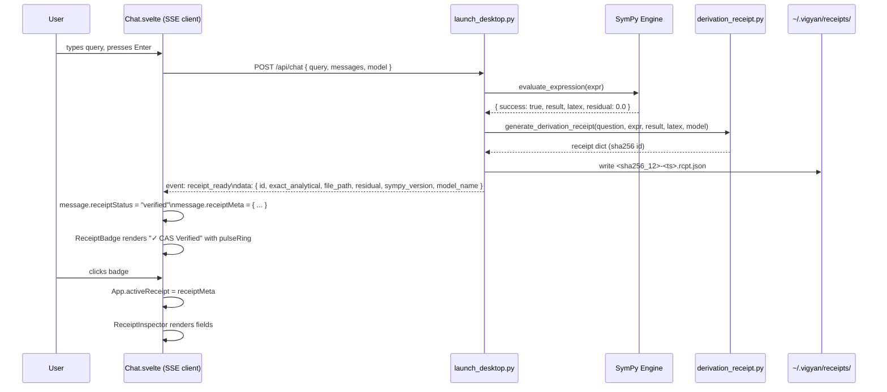
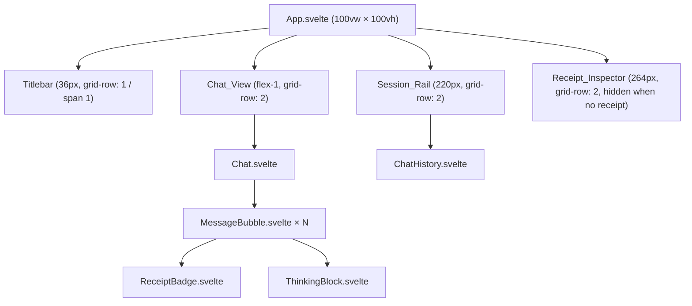
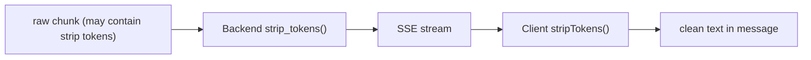

# Design Document

## Overview

Vigyan Pro v5.0.8 Free Tier is a focused stabilization and identity release. It fixes three critical bugs in v5.0.7 (false CAS badges, broken scroll, raw token leakage), replaces the model fleet with three Apache 2.0 sovereign models, wires the existing derivation receipt system end-to-end through the SSE event stream, redesigns the UI shell with the ExperimentLab token system, and adds `vigyan verify` and `vigyan receipts` CLI commands.

The design keeps the existing Svelte 5 + Tauri v2 + Python bridge architecture intact. No new IPC transports are introduced. All changes are additive to the existing SSE event contract or surgical fixes to existing components.

---

## Architecture

### Top-Level Layout

The app switches from a 2-column layout (Chat + optional split canvas) to a stable 3-column CSS grid:

```
┌─────────────────────────────────────────────────────────────────────┐
│ Titlebar (36px, h-9, flex row)                                       │
├─────────────┬────────────────────────────────┬──────────────────────┤
│ Session_Rail│        Chat_View               │  Receipt_Inspector   │
│   220px     │          flex-1                │      264px           │
│             │                                │                      │
│  ChatHistory│  Chat.svelte                   │  ReceiptInspector    │
│  .svelte    │  MessageBubble.svelte          │  .svelte             │
│             │  ThinkingBlock.svelte          │                      │
└─────────────┴────────────────────────────────┴──────────────────────┘
```

The 3-column grid is declared in `App.svelte` via CSS Grid:

```
grid-template-columns: 220px 1fr 264px
grid-template-rows: 36px 1fr
```

The Receipt_Inspector column collapses (width: 0, hidden) when no receipt is active.

### Process Topology (unchanged)

```
Tauri shell (Rust/WebView)
  └── Svelte 5 frontend (WebView)
        └── HTTP + SSE → Python bridge (launch_desktop.py : 8085)
              ├── llama_supervisor.py → llama.cpp binary
              ├── SymPy engine (_FallbackSymPyEngine)
              └── derivation_receipt.py (generate + verify)
```

No new processes or IPC channels. The only new SSE event type is `receipt_ready`.

### SSE Event Contract Extension

The existing SSE event types (`think`, `token`, `sympy`, `tool_result`, `done`, `tier_downgrade`, `ram_governor_trip`) are preserved. One event type is added:

| Event | Data fields | Direction |
|---|---|---|
| `receipt_ready` | `id`, `exact_analytical`, `file_path`, `residual`, `sympy_version`, `model_name` | backend → frontend |

---

## Components and Interfaces

### New Components

#### `frontend/src/components/ChatHistory.svelte`

The 220 px Session_Rail. Receives a list of past chat session summaries from `chatSessionStore` and renders them grouped by recency bucket (Today / Yesterday / Earlier).

**Props:**
```typescript
interface Props {
  sessions: ChatSession[];
  activeSessionId: string;
  onSelectSession: (id: string) => void;
  onNewChat: () => void;
}
```

**Behavior:**
- "New Chat" button at top; keyboard shortcut ⌘N displayed as a badge.
- Each session row shows a truncated title (first user message, max 40 chars) and a relative timestamp.
- Hover reveals a 130 ms background transition using `var(--t)`.
- Rail does not scroll horizontally; long titles clip with `text-overflow: ellipsis`.

#### `frontend/src/components/ReceiptInspector.svelte`

The 264 px right panel. Renders receipt fields in a `dl` grid with `dt` at 74 px and `dd` taking the remainder.

**Props:**
```typescript
interface Props {
  receipt: ReceiptMeta | null;
  onRerunVerification: () => void;
  onCopyLatex: () => void;
  onExportPdf: () => void;
}

interface ReceiptMeta {
  id: string;             // "sha256:..."
  filePath: string;
  exactAnalytical: string;
  latex: string;
  residual: string;       // e.g. "0.000e+00"
  sympyVersion: string;
  modelName: string;
  createdAt: string;      // ISO8601
  runtimeMs: number;
}
```

**Layout:**
```
┌──────────────────────────────────┐
│ "Receipt Inspector"  [close ×]  │  (header, 44px)
├──────────────────────────────────┤
│ [placeholder text]               │  (when receipt = null)
├──────────────────────────────────┤
│ dt: Expression                   │
│ dd: <code block>                 │
│ dt: SymPy Version                │
│ dd: 1.14.0                       │
│ dt: Residual Error               │
│ dd: 0.000e+00                    │
│ dt: Model                        │
│ dd: gemma-4-e4b...               │
│ dt: Runtime                      │
│ dd: 142 ms                       │
│ dt: Network Bytes                │
│ dd: 0                            │
│ dt: Receipt Hash                 │
│ dd: sha256:abc123... (truncated) │
├──────────────────────────────────┤
│ [Re-run Verification]            │
│ [Copy as LaTeX] [Export PDF]     │
└──────────────────────────────────┘
```

**Re-run Verification** calls `POST /api/receipt/verify` with `{ file_path }`. The backend calls `verify_derivation_receipt()` and returns the result. The panel shows a loading spinner (the `blink` animation) while awaiting the response and updates the status within 10 seconds or shows an error.

#### `frontend/src/components/CommandPalette.svelte`

A modal overlay triggered by ⌘K / Ctrl+K.

**Props:**
```typescript
interface Props {
  open: boolean;
  onClose: () => void;
  commands: Command[];
}

interface Command {
  label: string;
  shortcut?: string;
  action: () => void;
}
```

**Layout:** 480 px wide, positioned `15vh` from top, centered horizontally. Rendered in a portal at the `<body>` root to escape stacking context issues.

**Behavior:**
- Text input is auto-focused on open.
- Command list filters case-insensitively on every keypress (no debounce needed; list is small).
- ArrowUp / ArrowDown move selection. Enter executes selected command and closes.
- Escape closes without executing.
- Backdrop click closes.

**Default commands:**
1. New session (⌘N)
2. Open receipts
3. Toggle theme
4. Re-run verification
5. Export receipt as PDF
6. Settings (⌘,)

#### `frontend/src/components/ReceiptBadge.svelte`

An inline badge rendered inside `MessageBubble.svelte` for every assistant message.

**Props:**
```typescript
type ReceiptStatus = "verified" | "unverified" | "unable_to_check";

interface Props {
  status: ReceiptStatus;
  onClick?: () => void;
}
```

**Visual states:**

| Status | Dot color | Label | Animation |
|---|---|---|---|
| `verified` | `var(--ok)` (#3FB950) | "✓ CAS Verified" | `pulseRing` once on mount |
| `unverified` | `var(--warn)` (#D29922) | "⚠ Unverified — LLM heuristic" | none |
| `unable_to_check` | `var(--text-3)` (#7C7C85) | "✗ Unable to Check" | none |

The badge is a `<button>` only when `status === "verified"` (clicking it opens the Receipt_Inspector). For the other two states it is a `<span>` with `role="status"`.

---

### Modified Components

#### `frontend/src/App.svelte`

**Changes:**
1. Replace 2-column layout (`flex-row`) with a 3-column CSS Grid.
2. Add `activeReceipt: ReceiptMeta | null` state fed into `ReceiptInspector`.
3. Add `commandPaletteOpen: boolean` state; wire ⌘K / Ctrl+K in `handleGlobalKeydown`.
4. Remove hardcoded `emerald` and `sky-blue` accent classes; replace with design token classes.
5. Update `Model_Switcher` segment labels to "4B Daily", "7B Production", "12B Advanced".
6. Update `handleSegmentClick` filenames to the new model catalog.
7. Mount `ChatHistory.svelte` in left rail slot.
8. Mount `ReceiptInspector.svelte` in right panel slot; pass `activeReceipt`.
9. Mount `CommandPalette.svelte` at root level (outside the grid).
10. Add licence-first-run modal: on mount, if `~/.vigyan/config.json` lacks `licence_accepted`, show a blocking modal with "I Understand". On confirmation, call `POST /api/config` with `{ licence_accepted: true, accepted_at: <ISO8601> }`.

#### `frontend/src/app.css`

**Replace entirely.** Remove all `--obsidian-*` tokens. Replace `--emerald-accent` and all emerald/sky references with the new token set:

```css
:root {
  --bg:      #0A0A0B;
  --surface: #111113;
  --line:    rgba(255,255,255,.07);
  --line-2:  rgba(255,255,255,.045);
  --text:    #F1F1F3;
  --text-2:  #9C9CA4;
  --text-3:  #7C7C85;
  --accent:  #FF7B5F;
  --ok:      #3FB950;
  --warn:    #D29922;
  --err:     #E5534B;
  --font:    -apple-system, BlinkMacSystemFont, "Segoe UI", system-ui, sans-serif;
  --mono:    ui-monospace, SFMono-Regular, "SF Mono", Menlo, Consolas, monospace;
  --t:       130ms cubic-bezier(.2,0,0,1);
  --r:       6px;
}

@keyframes fadeUp {
  from { opacity: 0; transform: translateY(6px); }
  to   { opacity: 1; transform: translateY(0); }
}

@keyframes pulseRing {
  0%   { box-shadow: 0 0 0 0   rgba(63,185,80,.5); }
  70%  { box-shadow: 0 0 0 6px rgba(63,185,80,0); }
  100% { box-shadow: 0 0 0 0   rgba(63,185,80,0); }
}

@keyframes sweep {
  from { background-position: -200% center; }
  to   { background-position:  200% center; }
}

@keyframes blink {
  0%, 100% { opacity: .85; }
  50%       { opacity: .18; }
}

@media (prefers-reduced-motion: reduce) {
  *, *::before, *::after {
    animation-duration: 0.001ms !important;
    transition-duration: 0.001ms !important;
  }
}
```

Background and global font updated to use `var(--bg)` and `var(--font)`.

#### `frontend/src/components/Chat.svelte`

**Changes:**

1. **Scroll fix.** Add a `userHasScrolledUp` derived boolean. After every `scrollEl.scrollTop` write, capture `scrollEl.scrollHeight - scrollEl.scrollTop - scrollEl.clientHeight`. If this value exceeds 80 when the user manually triggers a scroll event, set `userScrolledUp = true`. On new token / `thinkingDone` flip / `done` event, call `scrollToBottom()` only if `!userScrolledUp`. On user message send, always call `scrollToBottom()` and reset `userScrolledUp = false`.

   ```typescript
   let userScrolledUp = $state(false);

   function onScrollEvent() {
     if (!scrollEl) return;
     const distFromBottom = scrollEl.scrollHeight - scrollEl.scrollTop - scrollEl.clientHeight;
     userScrolledUp = distFromBottom > 80;
   }

   function scrollToBottom(force = false) {
     if (!force && userScrolledUp) return;
     requestAnimationFrame(() => {
       if (scrollEl) scrollEl.scrollTop = scrollEl.scrollHeight;
     });
   }
   ```

   Bind `onscroll={onScrollEvent}` to the scroll container.

2. **Receipt parsing.** In the SSE event handler, add a branch for `eventName === "receipt_ready"`:

   ```typescript
   } else if (eventName === "receipt_ready") {
     const meta: ReceiptMeta = {
       id: parsed.id,
       filePath: parsed.file_path,
       exactAnalytical: parsed.exact_analytical,
       latex: parsed.latex ?? "",
       residual: parsed.residual ?? "0.000e+00",
       sympyVersion: parsed.sympy_version ?? "",
       modelName: parsed.model_name ?? "",
       createdAt: new Date().toISOString(),
       runtimeMs: parsed.runtime_ms ?? 0,
     };
     chatStore.messages[idx].receiptMeta = meta;
     chatStore.messages[idx].receiptStatus = "verified";
     chatStore.messages[idx].artifact = {
       ...chatStore.messages[idx].artifact,
       verified: true,  // set only here, never hardcoded
     };
     onReceiptReady?.(meta);
   }
   ```

3. **Token strip (client side).** In the `token` event handler, apply:
   ```typescript
   const STRIP_TOKENS = ["<answer>","</answer>","<solution>","</solution>",
     "<|im_end|>","<|im_start|>","<|endoftext|>","</sstream>"];
   function stripTokens(text: string): string {
     let out = text;
     for (const t of STRIP_TOKENS) out = out.split(t).join("");
     return out;
   }
   tokenText = stripTokens(tokenText);
   ```
   This is applied after the existing regex strip already in the handler.

4. **New Chat animation.** When `chatStore.messages.length` transitions from non-zero to zero (clear), apply the `fadeUp` animation class to the welcome-state container.

5. **Props addition:** `onReceiptReady?: (meta: ReceiptMeta) => void` — called when a receipt_ready event arrives, so App.svelte can update `activeReceipt`.

#### `frontend/src/components/MessageBubble.svelte`

**Changes:**

1. Add `receiptStatus?: ReceiptStatus` and `receiptMeta?: ReceiptMeta` to `Props`.
2. Import and render `<ReceiptBadge>` after the main content `<div>` for assistant messages.
3. Remove the hardcoded `artifact.verified` check in the existing badge span. The verified state now comes from `receiptStatus === "verified"`.
4. Replace `border-[#38bdf8]` and `text-[#38bdf8]` classes with `border-[var(--accent)]` / `text-[var(--accent)]`.

#### `frontend/src/components/InlineArtifactPill.svelte`

**Changes:**

1. Remove the hardcoded `{#if artifact.verified}` CAS Verified span. Replace with a `<ReceiptBadge status={...} />` where status is passed as a prop from the parent `MessageBubble`.
2. Replace sky-blue color classes with `var(--accent)`.
3. Active state ring changes from `border-[#38bdf8]` to `border-[var(--accent)]`.

#### `frontend/src/components/SettingsPanel.svelte`

**Changes:**

1. Add a "Licence" section at the bottom of the settings body:
   - Label: "Personal — Free Tier"
   - Acceptance date read from `~/.vigyan/config.json` via `GET /api/config`
   - "View Licence" link that opens `LICENCE-FREE-TIER.md` via `shell.open()` (Tauri API)
2. Update version badge from `v5.0.7` to `v5.0.8`.
3. Replace colour tokens (bg, border) with the new token set.

#### `frontend/src/lib/chatStore.svelte.ts`

**Changes:**

Add `receiptStatus` and `receiptMeta` to the `Message` interface:

```typescript
export type ReceiptStatus = "verified" | "unverified" | "unable_to_check";

export interface ReceiptMeta {
  id: string;
  filePath: string;
  exactAnalytical: string;
  latex: string;
  residual: string;
  sympyVersion: string;
  modelName: string;
  createdAt: string;
  runtimeMs: number;
}

export interface Message {
  // ... existing fields ...
  receiptStatus?: ReceiptStatus;
  receiptMeta?: ReceiptMeta;
}
```

No changes to persistence logic; `receiptMeta` serializes naturally via `JSON.stringify`.

#### `frontend/src/lib/ollama.ts`

**Changes:**

1. Add `receipt_ready` to the SSE parser's event name handling (pass through to `onChunk` as a new chunk type `"receipt_ready"`).
2. Update `DEFAULT_MODEL` to `"gemma:4b"`.
3. Add `StreamChunk` type `"receipt_ready"` variant carrying `receiptData` field.
4. Update `STRIP_TOKENS` constant in the `token` event branch to include all 8 tokens.

---

## Data Models

### Extended `Message` (TypeScript)

```typescript
interface Message {
  id: string;
  role: "user" | "assistant";
  content: string;
  thinking: string;
  thinkingDone: boolean;
  streaming: boolean;
  sympyGrounding?: string;
  toolResults?: ToolResult[];
  attachment?: Attachment;
  digest?: Digest;
  artifact?: Artifact;
  receiptStatus?: ReceiptStatus;   // NEW
  receiptMeta?: ReceiptMeta;       // NEW
}
```

### `ReceiptMeta` (TypeScript)

Defined in `chatStore.svelte.ts`; mirrors the SSE `receipt_ready` payload fields.

### `ChatSession` (TypeScript)

New type for the Session_Rail:

```typescript
interface ChatSession {
  id: string;
  title: string;           // first user message, truncated
  createdAt: number;       // Unix ms
  messageCount: number;
  lastActivity: number;    // Unix ms
}
```

Sessions are persisted in `localStorage` under key `"vigyan_sessions"`.

### Receipt JSON Schema (`*.rcpt.json`)

The on-disk schema is defined in `derivation_receipt.py` and unchanged. Key fields used by the frontend:

```
{
  "id": "sha256:<hex64>",
  "created_at": "<ISO8601>",
  "question": "...",
  "planner": { "model": "...", "quant": "..." },
  "toolchain": { "sympy": "1.14.0" },
  "derivation": [
    {
      "step": 0,                       // 0-indexed
      "expression": "...",
      "exact_analytical": "...",
      "latex": "...",
      "numeric_approx": null
    }
  ],
  "verification": { "status": "PASSED", "residual_error": "0.000e+00" }
}
```

`step` is 0-indexed. The first derivation step is `step: 0`.

### Model Catalog (Python)

```python
ALLOWED_SOVEREIGN_MODELS = {
    "gemma-4-e4b-qat-q4-0.gguf",          # Daily 4B
    "vigyan-7b-quad-master-q4_k_m.gguf",   # Production 7B
    "gemma-4-12b-qat-q4-0.gguf",           # Advanced 12B
}

SOVEREIGN_PRODUCTION_MODELS = [
    {
        "id": "gemma-4-e4b",
        "name": "Gemma 4 E4B Daily",
        "tag": "gemma:4b",
        "short_label": "4B Daily",
        "filename": "gemma-4-e4b-qat-q4-0.gguf",
        "size_bytes": 2684354560,
        "size_formatted": "2.5 GB",
        "ram_required_gb": 5.0,
        "ctx_size": 131072,
        "template": "gemma4",
    },
    {
        "id": "vigyan-7b",
        "name": "Vigyan-7B Quad-Master",
        "tag": "vigyan:7b",
        "short_label": "7B Production",
        "filename": "vigyan-7b-quad-master-q4_k_m.gguf",
        "size_bytes": 4467000000,
        "size_formatted": "4.16 GB",
        "ram_required_gb": 8.0,
        "ctx_size": 4096,
        "template": "olmo2",
    },
    {
        "id": "gemma-4-12b",
        "name": "Gemma 4 12B Advanced",
        "tag": "gemma:12b",
        "short_label": "12B Advanced",
        "filename": "gemma-4-12b-qat-q4-0.gguf",
        "size_bytes": 7193182208,
        "size_formatted": "6.7 GB",
        "ram_required_gb": 13.4,
        "ctx_size": 262144,
        "template": "gemma4",
    },
]

MODEL_ALIASES = {
    # Daily 4B
    "4b": "gemma-4-e4b-qat-q4-0.gguf",
    "gemma4": "gemma-4-e4b-qat-q4-0.gguf",
    "gemma:4b": "gemma-4-e4b-qat-q4-0.gguf",
    # Production 7B
    "7b": "vigyan-7b-quad-master-q4_k_m.gguf",
    "vigyan:7b": "vigyan-7b-quad-master-q4_k_m.gguf",
    # Advanced 12B
    "12b": "gemma-4-12b-qat-q4-0.gguf",
    "gemma:12b": "gemma-4-12b-qat-q4-0.gguf",
    "gemma4:12b": "gemma-4-12b-qat-q4-0.gguf",
}
```

### Gemma 4 Prompt Template

```python
GEMMA4_TEMPLATE = (
    "<bos><start_of_turn>user\n{system}\n\n{prompt}<end_of_turn>\n"
    "<start_of_turn>model\n"
)
GEMMA4_STOP = ["<end_of_turn>"]
```

Applied in `launch_desktop.py` when `model_info["template"] == "gemma4"`.

---

## Backend File-by-File Change Summary

### `src/vigyan_cli.py`

1. **Model catalog replacement.** Replace `ALLOWED_SOVEREIGN_MODELS`, `SOVEREIGN_PRODUCTION_MODELS`, and `MODEL_ALIASES` constants with the new 3-model definitions above.
2. **`cmd_models()`** — update table header to show "4B Daily / 7B Production / 12B Advanced"; update alias display dict.
3. **`cmd_pull()`** — update error message to reference `4b`, `7b`, `12b`; add RAM confirmation prompt when `avail_ram < req_ram` (currently advisory only — change to blocking confirmation).
4. **`cmd_verify()` (new function):**

   ```python
   def cmd_verify(filepath: str) -> int:
       """Exit 0 = verified, 1 = failed, 2 = file/JSON error."""
       if not os.path.exists(filepath):
           print(f"Error: file not found: {filepath}", file=sys.stderr)
           return 2
       try:
           with open(filepath, "r", encoding="utf-8") as f:
               data = json.load(f)
       except json.JSONDecodeError as e:
           print(f"Error: invalid JSON in receipt file", file=sys.stderr)
           return 2
       t0 = time.monotonic()
       from derivation_receipt import verify_derivation_receipt, format_cli_receipt_report
       valid, reason, details = verify_derivation_receipt(data)
       elapsed_ms = int((time.monotonic() - t0) * 1000)
       print(format_cli_receipt_report(data, valid, reason, details))
       print(f"Verification completed in {elapsed_ms} ms")
       if valid:
           print("VERIFIED")
           return 0
       return 1
   ```

   Step numbers in `format_cli_receipt_report` are emitted as-is from `verify_derivation_receipt()` which uses the `step` field from the receipt (0-indexed).

5. **`cmd_receipts()` (new function):**

   ```python
   def cmd_receipts(verify_all: bool = False, export_dir: str | None = None) -> int:
       receipts_dir = os.path.expanduser("~/.vigyan/receipts")
       if not os.path.isdir(receipts_dir):
           print("No receipts found in ~/.vigyan/receipts/")
           return 0
       files = sorted(
           [f for f in os.listdir(receipts_dir) if f.endswith(".rcpt.json")],
           key=lambda f: os.path.getmtime(os.path.join(receipts_dir, f)),
           reverse=True,
       )
       if not files:
           print("No receipts found in ~/.vigyan/receipts/")
           return 0
       if export_dir:
           os.makedirs(export_dir, exist_ok=True)
           count = 0
           for f in files:
               shutil.copy2(os.path.join(receipts_dir, f), os.path.join(export_dir, f))
               count += 1
           print(f"Exported {count} receipt(s) to {export_dir}")
           return 0
       # Print table ...
   ```

6. **`main()` subcommand routing** — add `verify` and `receipts` branches.
7. **`print_usage()`** — add new commands to the help text.
8. **`--version` flag** — append `" Licence: Non-Commercial Free Tier"` to output.

### `src/launch_desktop.py`

1. **Prompt template routing.** In the chat handler, detect `model_info["template"]` and format the prompt accordingly:

   ```python
   if template == "gemma4":
       formatted = GEMMA4_TEMPLATE.format(system=system_prompt, prompt=user_query)
       stop = GEMMA4_STOP
   else:  # olmo2 / legacy
       formatted = existing_olmo2_format(system_prompt, user_query)
       stop = existing_stop_tokens
   ```

2. **Token strip (backend).** Add a `strip_tokens()` helper applied to every chunk before SSE emission:

   ```python
   STRIP_TOKENS = [
       "<answer>", "</answer>", "<solution>", "</solution>",
       "<|im_end|>", "<|im_start|>", "<|endoftext|>", "</sstream>",
   ]

   def strip_tokens(text: str) -> str:
       for tok in STRIP_TOKENS:
           text = text.replace(tok, "")
       return text
   ```

   Applied in the streaming loop before `yield f"event: token\ndata: {json.dumps(chunk)}\n\n"`.

3. **Receipt wiring.** After a successful SymPy evaluation (`result["success"] == True`), call `generate_derivation_receipt()` and save:

   ```python
   from derivation_receipt import generate_derivation_receipt
   import hashlib, datetime

   receipt = generate_derivation_receipt(
       question=user_query,
       expression=result["expression"],
       exact_result=result["result"],
       latex_result=result["latex"],
       numeric_approx=result.get("numeric_approx"),
       planner_model=active_model_name,
   )
   receipts_dir = os.path.expanduser("~/.vigyan/receipts")
   os.makedirs(receipts_dir, exist_ok=True)
   sha_prefix = receipt["id"].split(":")[1][:12]
   ts = datetime.datetime.now().strftime("%Y%m%d_%H%M%S")
   filename = f"{sha_prefix}-{ts}.rcpt.json"
   filepath = os.path.join(receipts_dir, filename)
   with open(filepath, "w", encoding="utf-8") as f:
       json.dump(receipt, f, indent=2)

   yield (
       f"event: receipt_ready\n"
       f"data: {json.dumps({'id': receipt['id'], 'exact_analytical': result['result'], "
       f"'file_path': filepath, 'residual': receipt['verification']['residual_error'], "
       f"'sympy_version': receipt['toolchain']['sympy'], 'model_name': active_model_name})}\n\n"
   )
   ```

4. **RAM governor.** Already partially implemented; add check at model load:

   ```python
   avail_ram = hw.get("avail_ram_gb", 8.0)
   if model_info["ram_required_gb"] > avail_ram * 0.85:
       yield f"event: error\ndata: {json.dumps({'error': 'Insufficient RAM to load this model safely.'})}\n\n"
       return
   ```

5. **Receipt verify endpoint.** Add `POST /api/receipt/verify`:

   ```python
   @app.route("/api/receipt/verify", methods=["POST"])
   def api_receipt_verify():
       data = request.get_json()
       file_path = data.get("file_path", "")
       if not os.path.isfile(file_path):
           return jsonify({"valid": False, "reason": "file not found"}), 404
       with open(file_path, "r") as f:
           receipt = json.load(f)
       from derivation_receipt import verify_derivation_receipt
       valid, reason, details = verify_derivation_receipt(receipt)
       return jsonify({"valid": valid, "reason": reason, "details": details})
   ```

6. **Config endpoints.** Add `GET /api/config` and `POST /api/config` to read/write `~/.vigyan/config.json`.

### `src/llama_supervisor.py`

1. Update `ALLOWED_MODELS` whitelist to `ALLOWED_SOVEREIGN_MODELS` from the new catalog.
2. Add context window awareness: when starting `llama.cpp`, read `ctx_size` from the model info dict and pass `--ctx-size <ctx_size>` to the subprocess.
3. Update default port comments and any hardcoded model references.

### `src/derivation_receipt.py`

No functional changes needed. The `step` field in generated receipts uses the value passed in the `steps` list (0-indexed by convention — step 0 is the first derivation step). The `verify_derivation_receipt()` function already reports the `step` value from the receipt dict verbatim.

One documentation change: add a comment clarifying that `step` values are 0-indexed:

```python
# "step" is 0-indexed: step 0 is the first derivation step.
```

---

## Mermaid Diagrams

### Receipt Flow: Backend → Frontend



### CSS Grid Layout



### Token Strip Idempotency



Both strip passes apply the same 8-token list. If the backend strips correctly, the frontend strip is a no-op. If a token survives to the client (e.g., from a cached partial chunk), the frontend removes it.

---

## Correctness Properties

*A property is a characteristic or behavior that should hold true across all valid executions of a system — essentially, a formal statement about what the system should do. Properties serve as the bridge between human-readable specifications and machine-verifiable correctness guarantees.*

### Property 1: Verified badge requires success:true receipt event

*For any* sequence of SSE events processed by Chat.svelte for a given assistant message, `message.receiptStatus === "verified"` if and only if the sequence contains exactly one `receipt_ready` event whose payload has `residual ≤ 1e-10`. For all other event sequences (no receipt event, or receipt with higher residual, or `success: false`), `message.receiptStatus` must not equal `"verified"`.

**Validates: Requirements 1.1, 1.3, 1.4**

---

### Property 2: Token strip idempotency

*For any* string `text` (including empty strings, strings with no strip tokens, and strings with multiple occurrences of strip tokens), `stripTokens(stripTokens(text)) === stripTokens(text)`. Applying the strip function twice produces the same result as applying it once.

**Validates: Requirements 3.1, 3.2, 3.3**

---

### Property 3: Strip tokens absent from output

*For any* input string `text` and any token `tok` in the strip list `["<answer>", "</answer>", "<solution>", "</solution>", "<|im_end|>", "<|im_start|>", "<|endoftext|>", "</sstream>"]`, `stripTokens(text)` does not contain `tok`.

**Validates: Requirements 3.1, 3.2**

---

### Property 4: All model aliases resolve to an allowed filename

*For any* key in `MODEL_ALIASES`, `MODEL_ALIASES[key]` must be a value that exists in `ALLOWED_SOVEREIGN_MODELS`. No alias may map to a filename outside the authorized set.

**Validates: Requirements 4.3, 4.4, 4.5**

---

### Property 5: Receipt round-trip produces exit 0

*For any* valid (expression, result) pair that SymPy can evaluate symbolically, calling `generate_derivation_receipt(question, expression, str(result), latex(result), None)` to produce a receipt dict, then calling `verify_derivation_receipt(receipt)` on that dict, must return `(True, _, _)` — that is, the round-trip from generation to verification is always consistent.

**Validates: Requirements 6.6, 10.2**

---

### Property 6: Receipt content matches SymPy output

*For any* expression string `E` and SymPy result `R`, calling `generate_derivation_receipt(question, E, str(R), latex(R), None)` must produce a receipt where `receipt["derivation"][0]["exact_analytical"] == str(R)`. The first derivation step (index 0) exactly records the computed result.

**Validates: Requirements 6.7**

---

### Property 7: Scroll-to-bottom on send ignores scroll offset

*For any* initial scroll offset of the chat container (including offset = 0 and offset = maximum), when the user sends a new message, `scrollEl.scrollTop` after the send equals `scrollEl.scrollHeight` (or as close as `requestAnimationFrame` allows). The send action always resets scroll position to the bottom.

**Validates: Requirements 2.4**

---

### Property 8: Divergence error identifies correct 0-indexed step

*For any* receipt with `n` derivation steps, if `verify_derivation_receipt()` detects a mathematical divergence at step index `i` (0 ≤ i < n), the returned reason string must contain `str(i)` (the 0-indexed step number). The error report must not report step `i+1` or any other index.

**Validates: Requirements 10.4**

---

## Error Handling

### Backend Errors

| Condition | Backend action | Frontend display |
|---|---|---|
| SymPy evaluation timeout (> 2.5 s) | Emit SSE `done` with no `sympy` event | `receiptStatus = "unable_to_check"` |
| SymPy parse failure | Emit SSE `done` with no `sympy` event | `receiptStatus = "unable_to_check"` |
| Receipt write failure (disk full) | Log warning; emit `done` without `receipt_ready` | `receiptStatus = "unverified"` |
| RAM governor trip | Emit `ram_governor_trip` SSE event + `error` event | Error message in chat; model not loaded |
| Model file not found at startup | Emit `error` event: "No model loaded" | Error message in chat; badge = "unable_to_check" |

### CLI Errors

| Condition | Exit code | Message |
|---|---|---|
| `vigyan verify` — file not found | 2 | `Error: file not found: <path>` |
| `vigyan verify` — invalid JSON | 2 | `Error: invalid JSON in receipt file` |
| `vigyan verify` — hash mismatch | 1 | Audit report + expected/computed hashes |
| `vigyan verify` — SymPy divergence at step N | 1 | Audit report + "Step N: computed <X> != expected <Y>" (N is 0-indexed) |
| `vigyan pull` — insufficient RAM | Blocks with prompt | RAM advisory + `[y/N]` confirmation |
| `vigyan pull` — insufficient disk | 1 | `Error: Insufficient disk space` |

### Frontend Errors

- If `POST /api/receipt/verify` returns a non-200 response, the Receipt_Inspector shows "Verification failed: [reason]" in the status area.
- If `POST /api/receipt/verify` does not respond within 10 seconds, the inspector shows "Verification timed out".
- If localStorage is unavailable or quota is exceeded, `chatStore.save()` silently ignores the error (existing behavior preserved).

---

## Testing Strategy

### Unit Tests

Unit tests (Jest or Vitest) cover:

- `stripTokens()` with all 8 tokens in various positions (start, middle, end, adjacent, nested, repeated).
- `ReceiptBadge` renders correct label and dot color for each of the three `ReceiptStatus` values.
- `ReceiptInspector` shows placeholder when `receipt = null`.
- `CommandPalette` filters commands case-insensitively and clears filter on close.
- `cmd_verify()` returns exit code 2 when file not found, 2 for invalid JSON, 0 for valid receipt, 1 for tampered receipt.
- `cmd_receipts()` returns "No receipts found" when directory is empty.
- `MODEL_ALIASES` resolves `4b`, `gemma4`, `gemma:4b`, `7b`, `vigyan:7b`, `12b`, `gemma:12b`, `gemma4:12b` to the correct filenames.

### Property-Based Tests

The property-based testing library for Python is **Hypothesis**; for TypeScript, **fast-check**.

**Test tag format:** `# Feature: vigyan-pro-free-tier, Property N: <property_text>`

#### PBT 1 (TypeScript, fast-check) — Token strip idempotency and completeness

```typescript
// Feature: vigyan-pro-free-tier, Property 2: Token strip idempotency
// Feature: vigyan-pro-free-tier, Property 3: Strip tokens absent from output
fc.assert(fc.property(fc.string(), (text) => {
  const once = stripTokens(text);
  const twice = stripTokens(once);
  // Idempotency
  expect(twice).toBe(once);
  // Completeness
  for (const tok of STRIP_TOKENS) {
    expect(once).not.toContain(tok);
  }
}), { numRuns: 500 });
```

#### PBT 2 (Python, Hypothesis) — Receipt round-trip

```python
# Feature: vigyan-pro-free-tier, Property 5: Receipt round-trip produces exit 0
# Feature: vigyan-pro-free-tier, Property 6: Receipt content matches SymPy output
from hypothesis import given, settings
from hypothesis import strategies as st

@given(
    question=st.text(min_size=1, max_size=200),
    expr=st.sampled_from(["x**2 + 1", "sin(x)", "exp(-x)", "x**3 - x"]),
    num=st.one_of(st.none(), st.floats(allow_nan=False, allow_infinity=False))
)
@settings(max_examples=100)
def test_receipt_round_trip(question, expr, num):
    import sympy as sp
    from sympy.parsing.sympy_parser import parse_expr
    x = sp.Symbol("x")
    result = parse_expr(expr)
    receipt = generate_derivation_receipt(
        question=question,
        expression=expr,
        exact_result=str(result),
        latex_result=sp.latex(result),
        numeric_approx=num,
    )
    # Property 6: content matches
    assert receipt["derivation"][0]["exact_analytical"] == str(result)
    # Property 5: round-trip verifies
    valid, reason, _ = verify_derivation_receipt(receipt)
    assert valid, f"Verification failed: {reason}"
```

#### PBT 3 (Python, Hypothesis) — All aliases resolve to allowed filenames

```python
# Feature: vigyan-pro-free-tier, Property 4: All model aliases resolve to an allowed filename
from hypothesis import given
from hypothesis import strategies as st

@given(alias=st.sampled_from(list(MODEL_ALIASES.keys())))
def test_alias_resolves_to_allowed_model(alias):
    resolved = MODEL_ALIASES[alias]
    assert resolved in ALLOWED_SOVEREIGN_MODELS, \
        f"Alias '{alias}' resolves to '{resolved}' which is not in ALLOWED_SOVEREIGN_MODELS"
```

#### PBT 4 (Python, Hypothesis) — Divergence error identifies correct 0-indexed step

```python
# Feature: vigyan-pro-free-tier, Property 8: Divergence error identifies correct 0-indexed step
from hypothesis import given, settings
from hypothesis import strategies as st

@given(
    n_steps=st.integers(min_value=1, max_value=5),
    bad_step=st.integers(min_value=0, max_value=4),
)
@settings(max_examples=100)
def test_divergence_reports_correct_step(n_steps, bad_step):
    if bad_step >= n_steps:
        return  # skip: bad_step must be a valid index

    # Build a receipt with n_steps, corrupting step bad_step
    base_expr = "x**2"
    x = sp.Symbol("x")
    result = x**2
    steps = [
        {"step": i, "expression": base_expr, "exact_analytical": str(result)}
        for i in range(n_steps)
    ]
    # Inject divergence at bad_step
    steps[bad_step]["exact_analytical"] = str(result + 1)  # wrong answer

    receipt = generate_derivation_receipt(
        question="test", expression=base_expr,
        exact_result=str(result), latex_result=sp.latex(result),
        steps=steps,
    )
    valid, reason, details = verify_derivation_receipt(receipt)
    assert not valid
    assert str(bad_step) in reason, \
        f"Expected step index {bad_step} in reason, got: {reason}"
```

#### PBT 5 (TypeScript, fast-check) — Verified badge requires success:true

```typescript
// Feature: vigyan-pro-free-tier, Property 1: Verified badge requires success:true receipt event
fc.assert(fc.property(
  fc.record({
    hasReceiptEvent: fc.boolean(),
    residual: fc.float({ min: 0, max: 1e-5 }),
    successFlag: fc.boolean(),
  }),
  ({ hasReceiptEvent, residual, successFlag }) => {
    const events = hasReceiptEvent && successFlag
      ? [{ type: "receipt_ready", residual, success: true }]
      : [];
    const status = deriveReceiptStatus(events);
    const shouldBeVerified = hasReceiptEvent && successFlag && residual <= 1e-10;
    if (shouldBeVerified) {
      expect(status).toBe("verified");
    } else {
      expect(status).not.toBe("verified");
    }
  }
), { numRuns: 500 });
```

### Integration Tests

- Start the backend with the 3B model loaded; send a calculus query; assert a `.rcpt.json` file appears in `~/.vigyan/receipts/` within 5 seconds.
- Run `vigyan verify <generated_file>` on the receipt; assert exit code 0.
- Run `vigyan receipts` on a populated receipts directory; assert the table contains the expected filename row.

### Snapshot Tests

- CSS design token classes (Tailwind-based): snapshot the rendered HTML of `ReceiptBadge` for each status to catch regressions if Tailwind purges change.

